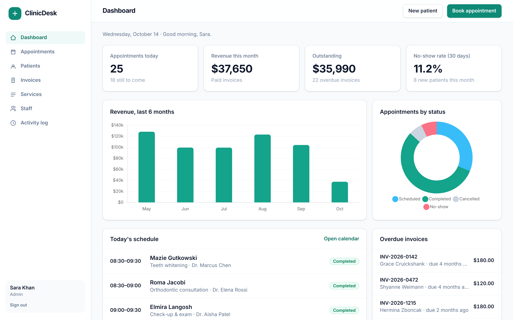
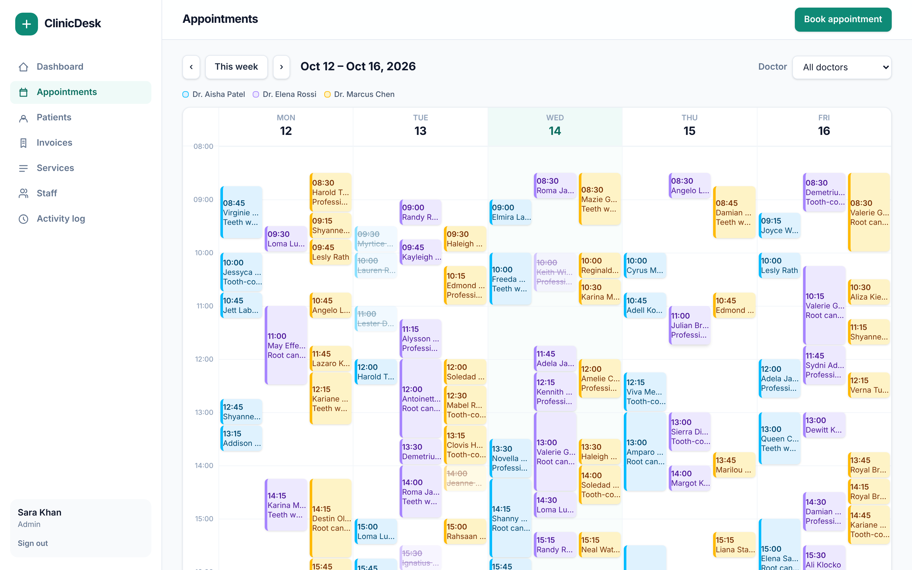
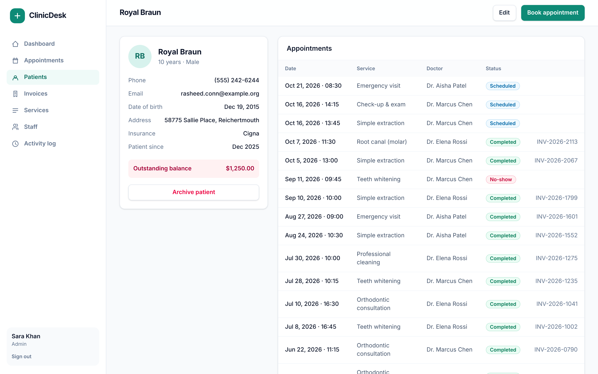
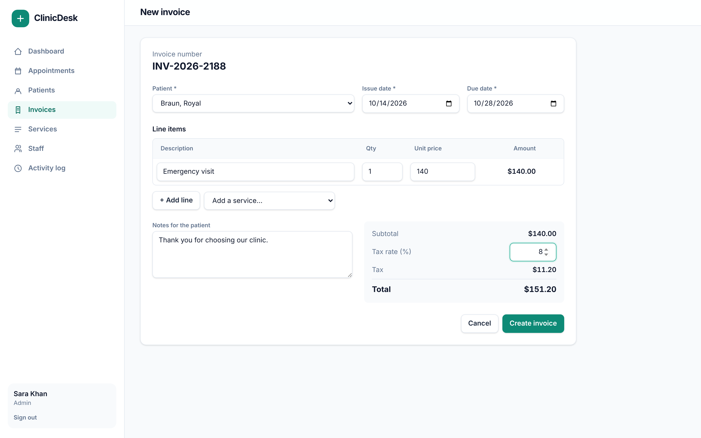
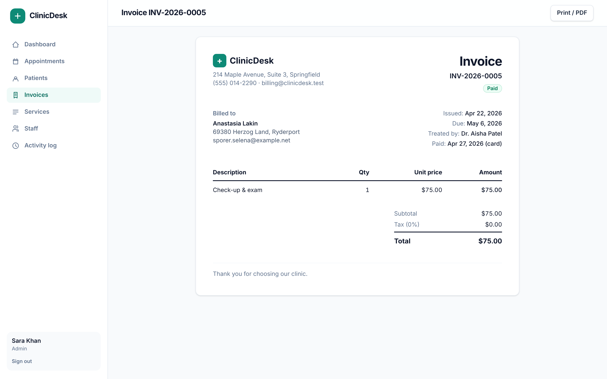

# ClinicDesk

**A clinic management dashboard built with Laravel: patients, appointments, invoices and staff in one place.**

ClinicDesk runs a small clinic's front desk:
- registering patients;
- booking appointments on a week calendar, without ever double-booking a doctor;
- issuing and collecting invoices;
- managing staff permissions.

The dashboard shows how the clinic is doing today.



| Week calendar (one lane per doctor) | Patient file |
|---|---|
|  |  |

| Invoice builder | Printable invoice |
|---|---|
|  |  |

## Features

- **Dashboard**
  - Today's appointments, revenue this month, outstanding balance, overdue invoices, and the 30-day no-show rate.
  - Charts: revenue over the last 6 months, and appointments by status (Chart.js).
  - Today's schedule with one-click "Complete", and an overdue invoices list.
- **Appointments**
  - Week calendar (Mon–Fri, 08:00–19:00) with a lane per doctor, a doctor filter, and a quick-view pop-up with status actions.
  - **Booking rules are enforced on the server:**
    - no double-booking the same doctor (back-to-back is fine; cancelled slots free up);
    - opening hours, and no weekends;
    - no booking in the past;
    - only active doctors can be booked;
    - the duration comes from the chosen service.
- **Patients:** search by name, full name, phone or email, patient files with visit history, invoices and outstanding balance, and soft-delete (archive) that keeps history.
- **Invoices**
  - A dynamic line-item builder (Alpine.js) that can add catalogue services and apply tax.
  - **Totals are recalculated on the server**, so tampered client values are ignored.
  - Numbers run in yearly sequence (`INV-2026-0042`), with one invoice per appointment.
  - Mark as paid with a payment method, or void. Paid invoices can't be voided.
  - Overdue filter, and a print / PDF-friendly layout.
- **Services and prices:** a catalogue with durations and prices, edited inline.
- **Staff and roles:** Admin, Receptionist and Doctor, enforced with Laravel Gates on every route and in the UI.
- **Activity log:** who registered, booked, invoiced or changed what, and when.
- **Security:** CSRF protection, rate-limited login, disabled accounts can't sign in, Form Request validation, and Eloquent everywhere (no raw SQL injection surface).

### Roles

| | Admin | Receptionist | Doctor |
|---|:-:|:-:|:-:|
| Dashboard and calendar | ✓ | ✓ | ✓ (own schedule) |
| View patient files | ✓ | ✓ | ✓ (no billing) |
| Register and edit patients, book appointments | ✓ | ✓ | |
| Update appointment status | ✓ | ✓ | own appointments |
| Invoices and payments | ✓ | ✓ | |
| Staff, services and activity log | ✓ | | |

## Tech stack

| Layer | Tools |
|---|---|
| Back end | Laravel 13, PHP 8.3+, Eloquent, Form Requests, Gates, PHP enums, database transactions |
| Front end | Blade, Tailwind CSS 4, Alpine.js, Chart.js, Vite |
| Database | SQLite by default; MySQL / PostgreSQL work unchanged |
| Quality | PHPUnit (26 feature tests), Laravel Pint, GitHub Actions |

## Quick start

```bash
git clone https://github.com/ahmad0187/clinicdesk-laravel.git
cd clinicdesk-laravel
composer install
cp .env.example .env
php artisan key:generate
touch database/database.sqlite
php artisan migrate --seed      # demo clinic: 5 staff, 140 patients, ~6 months of appointments and invoices
npm install && npm run build
php artisan serve
```

Open http://localhost:8000. Demo accounts (password `password`):

| Role | Email |
|---|---|
| Admin | `admin@clinicdesk.test` |
| Receptionist | `reception@clinicdesk.test` |
| Doctor | `dr.patel@clinicdesk.test` |

**Tests and code style:**
```bash
vendor/bin/phpunit
vendor/bin/pint --test
```

## Deploying to shared hosting (e.g. Hostinger)

1. Create a MySQL database. In `.env`, set `DB_CONNECTION=mysql` and the credentials, plus `APP_ENV=production`, `APP_DEBUG=false` and `APP_URL`.
2. Upload the project and point the domain's document root at the `public/` folder.
3. Over SSH, run:
   ```bash
   composer install --no-dev --optimize-autoloader
   php artisan migrate --force
   php artisan config:cache && php artisan route:cache && php artisan view:cache
   ```
4. Build the assets locally with `npm run build` and upload `public/build`.
5. Set the clinic details printed on invoices with `CLINIC_ADDRESS`, `CLINIC_PHONE` and `CLINIC_EMAIL`.

## Project structure

```
app/
  Enums/               Role, AppointmentStatus, InvoiceStatus (labels and badge styles)
  Http/Controllers/    Dashboard, Patients, Appointments, Invoices, Staff, Services, Activity, Auth
  Http/Requests/       Validation, including the appointment booking rules
  Models/              Patient, Appointment, Invoice, InvoiceItem, Service, ActivityLog, User
  Providers/           Role-based Gates
  Services/            DashboardStats
database/
  migrations/, factories/, seeders/   Schema and a realistic demo clinic
resources/views/       Blade views (layout, calendar, invoice builder, printable invoice…)
tests/Feature/         Auth, permissions, patients, booking rules, invoicing, dashboard
```

## License

MIT. Built by [Ahmad Murtaza](https://github.com/ahmad0187).
